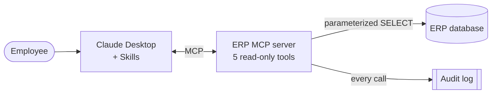

# ERP MCP Agent

**Ask your ERP questions in plain English, safely.** This project connects Claude
to business data (customers, stock, orders, invoices, payments) through a
**read-only MCP server**. Staff can ask "Which products are below reorder level?" or
"Is Oakhurst over its credit limit?" in Claude Desktop and get answers from live data.
Two **Claude Skills** turn recurring office work (a weekly sales summary, customer
payment reminders) into one-sentence requests.

The demo runs on a realistic, fully synthetic ERP database. The same pattern plugs
into SQL Server, PostgreSQL or an existing ERP such as Netsis, Logo or Odoo
(see [Adapting it to your ERP](#adapting-it-to-your-erp)).

> 🎬 **Demo video:** _2-minute walkthrough — link coming soon_



## What it can do

| Tool | Answers questions like | Parameters |
|---|---|---|
| `get_stock` | "Which products are below reorder level?" "How many 18V drills do we have?" | `query`, `category?`, `below_reorder_only?` |
| `get_order_status` | "What's the status of order SO-1537?" | `order_no` |
| `get_customer_balance` | "What is Foxglove's open balance? Are they over their credit limit?" | `customer` (code or name) |
| `list_overdue_orders` | "Which orders are late?" "Any delayed orders for Stonegate?" | `customer?`, `min_days_late?` |
| `get_kpi` | "How did revenue this quarter compare to last quarter?" "Top 5 customers in September?" | `metric`, `period_start`, `period_end`, `compare_previous?` |

`get_kpi` metrics: `revenue`, `top_products`, `top_customers`, `avg_order_value`, `overdue_receivables`.

| Skill | Ask | Produces |
|---|---|---|
| `weekly-sales-summary` | "Prepare this week's sales summary." | One-page manager report: revenue vs last week, top 5 products, stock at risk, late orders, overdue receivables, 3 action items |
| `customer-email-draft` | "Draft a payment reminder for Foxglove." | A polite email **draft** (never sent) plus internal review notes |

Sample outputs: [docs/sample-outputs.md](docs/sample-outputs.md)

## Quick start (about 5 minutes)

**Requirements:** Python 3.11+, [Claude Desktop](https://claude.ai/download), Git.

### 1. Install

**Windows (PowerShell)**
```powershell
git clone https://github.com/burakOzden1/erp-mcp-agent.git
cd erp-mcp-agent
python -m venv .venv
.\.venv\Scripts\python.exe -m pip install -e ".[dev]"
.\.venv\Scripts\python.exe scripts\seed_db.py
```

**macOS / Linux**
```bash
git clone https://github.com/burakOzden1/erp-mcp-agent.git
cd erp-mcp-agent
python3 -m venv .venv
.venv/bin/python -m pip install -e ".[dev]"
.venv/bin/python scripts/seed_db.py
```

`seed_db.py` creates `data/erp_demo.db` and prints the row counts and the planted
demo situations (9 products below reorder level, 12 late orders, 6 customers with
partially paid overdue invoices, 2 customers over their credit limit).

### 2. Connect Claude Desktop

Open Claude Desktop → **Settings → Developer → Edit Config** and add the server
under `mcpServers` (keep any servers you already have):

**Windows**
```json
{
  "mcpServers": {
    "erp-demo": {
      "command": "C:\\path\\to\\erp-mcp-agent\\.venv\\Scripts\\erp-mcp.exe"
    }
  }
}
```

**macOS**
```json
{
  "mcpServers": {
    "erp-demo": {
      "command": "/path/to/erp-mcp-agent/.venv/bin/erp-mcp"
    }
  }
}
```

Fully quit Claude Desktop (tray / menu bar → Quit) and reopen it. The five
`erp-demo` tools appear under the tools icon in a new chat.

### 3. Add the Skills (optional)

```bash
python scripts/package_skills.py
```

This writes `dist/skills/weekly-sales-summary.zip` and `dist/skills/customer-email-draft.zip`.
In Claude Desktop, go to **Settings → Capabilities**, make sure code execution is on,
and upload both zips under **Skills**.

## Example questions and answers

With the default dataset (data as of 2026-10-31):

| Question | Expected answer (abridged) |
|---|---|
| Which products are below reorder level? | 9 products. Most critical: SE-0012 Safety Glasses Economy (0 in stock, reorder level 75) and PT-0004 Cordless Drill 18V (1 in stock, reorder level 10). |
| What's the status of order SO-1537? | Shipped 2026-10-19, **16 days late** (promised 2026-10-15). 6 lines, $4,550.02. Invoice INV-10526 is unpaid, due 2026-12-03. |
| Show me customers with overdue invoices. | $26,599.80 overdue across 6 customers. Largest: Larkspur Building Services $5,910.94; Starling Industrial Supply has the oldest invoice (87 days). |
| Is Oakhurst over its credit limit? | Yes. Open balance $8,374.96 vs a $5,000 limit; $5,877.08 is overdue. |
| How did revenue this quarter compare to last quarter? | Q4 so far (October) $100,451.98 vs Q3 $310,513.09. The quarter is only one month old, so like-for-like (October vs July) is **−23.8%**. |
| Prepare this week's sales summary. | See [sample output](docs/sample-outputs.md#1-weekly-sales-summary--prepare-this-weeks-sales-summary). |
| Draft a payment reminder email for Foxglove. | See [sample output](docs/sample-outputs.md#2-customer-email-draft--draft-a-payment-reminder-email-for-foxglove). |

Typos are handled: asking about "Oakhust" returns *"Did you mean: Oakhurst Facilities Group (C-0007)?"*

## Security approach

Giving an AI model access to business data needs to be boring and predictable.
This server is designed so that the worst a confused prompt can do is read a
limited amount of data, and every read is recorded.

- **Read-only by construction.** The database is opened with SQLite's `mode=ro` and
  `PRAGMA query_only = ON`. Tools carry MCP `readOnlyHint` / `destructiveHint=false`
  annotations. Tests confirm that `INSERT`, `UPDATE`, `DELETE` and `DROP` fail.
- **No free-form SQL.** Claude cannot send SQL. Each tool runs one pre-written query
  with bound parameters; the KPI tool accepts only a fixed list of metrics.
- **Bounded results.** List tools return at most 50 rows and say when more exist.
- **Audit trail.** Every tool call (successful or not) is appended to
  `logs/audit.jsonl`:
  ```json
  {"ts": "2026-10-28T18:26:45.327+00:00", "tool": "get_stock", "params": {"query": "", "category": null, "below_reorder_only": true}, "row_count": 9, "duration_ms": 2.29, "status": "ok"}
  ```
- **Human in the loop.** The email Skill only drafts; a person reviews and sends.
- **Local by default.** The server runs on your machine over stdio. No ports are
  opened, and the demo needs no credentials.

More detail: [docs/architecture.md](docs/architecture.md).

## Adapting it to your ERP

The tool contract (names, parameters, JSON shape), audit log and Skills are
independent of the database. Moving to a real system touches two files:
`db.py` (connection) and `queries.py` (SQL).

1. **Pick the access path.** Connect to a reporting replica or read-only views
   rather than the production schema. Create a dedicated database user with
   `SELECT` permission on those views only.
2. **Map the concepts.** Every ERP has the same six building blocks: customer accounts,
   items/stock, sales orders and lines, invoices, and payments. Document which tables
   or views hold each, plus the status codes for open/shipped/delivered/cancelled.
3. **Swap the connection.** Replace `sqlite3` with `pyodbc` (SQL Server), `psycopg`
   (PostgreSQL) or the ERP's API/ODBC driver. Keep the read-only guarantees at the
   database-user level.
4. **Port the queries.** Rewrite the SQL in `queries.py` for the new schema and
   keep the returned JSON fields the same, so Claude and the Skills need no changes.
5. **Add business rules.** Multi-currency, branches or warehouses, VAT, credit
   control rules: add them as tool parameters or new fixed metrics, never as free SQL.
6. **Harden for production.** Add authentication if the server is exposed over HTTP,
   ship the audit log to your log platform, and apply row-level filters per user or role.

Typical targets: Microsoft SQL Server based ERPs (e.g. Netsis, Logo), PostgreSQL
based systems (e.g. Odoo), or accounting platforms with REST APIs (e.g. QuickBooks Online).

## Project structure

```
erp-mcp-agent/
├── src/erp_mcp/
│   ├── server.py        # MCP server and the 5 tool definitions
│   ├── queries.py       # parameterized SQL and KPI logic
│   ├── db.py            # read-only connection
│   └── audit.py         # JSON Lines audit log
├── skills/
│   ├── weekly-sales-summary/SKILL.md
│   └── customer-email-draft/SKILL.md
├── scripts/
│   ├── seed_db.py       # builds the synthetic ERP database
│   └── package_skills.py
├── tests/               # pytest: queries, MCP protocol, audit, skills, data integrity
└── docs/                # architecture, demo script, sample outputs
```

## Development

```bash
python -m pytest            # 52 tests, about 2 seconds
python scripts/seed_db.py --as-of today   # re-anchor the demo data to today's date
```

Configuration via environment variables: `ERP_DB_PATH` (database file) and
`ERP_AUDIT_LOG` (log file).

> **Windows:** quit Claude Desktop before re-running `pip install`. While Claude
> Desktop runs the server, Windows locks `.venv\Scripts\erp-mcp.exe` and the
> reinstall fails halfway.

Built with the official [MCP Python SDK](https://github.com/modelcontextprotocol/python-sdk) (`mcp` 2.3).

## License

MIT
