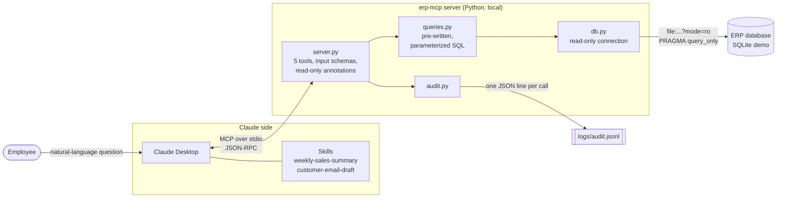
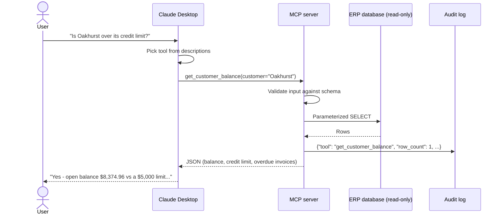
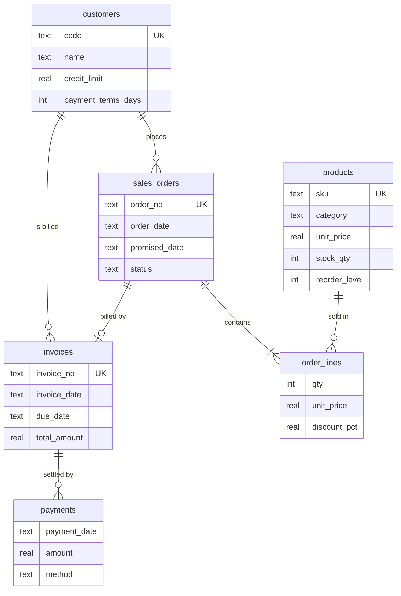

# Architecture

## Components

| Layer | File | Responsibility |
|---|---|---|
| Transport & tool contract | `src/erp_mcp/server.py` | Declares the 5 tools, their descriptions and typed parameters; converts expected errors into helpful messages |
| Business queries | `src/erp_mcp/queries.py` | Fixed SQL with bound parameters, name matching, KPI definitions, row caps |
| Data access | `src/erp_mcp/db.py` | Opens the database read-only (two independent guards) |
| Audit | `src/erp_mcp/audit.py` | Appends `ts, tool, params, row_count, duration_ms, status` to a JSON Lines file |
| Workflows | `skills/*/SKILL.md` | Step-by-step recipes Claude follows for recurring office tasks |

Only `db.py` and `queries.py` know the database schema. Pointing the server at a
different ERP means replacing those two files; the tool contract, audit log and
Skills stay the same.

## Request flow

## Security model

| Risk | Control |
|---|---|
| The model changes or deletes data | The database is opened with `mode=ro` **and** `PRAGMA query_only = ON`; no tool performs writes. Every tool is annotated `readOnlyHint=true, destructiveHint=false`. |
| SQL injection / arbitrary queries | No tool accepts SQL. Each tool runs one pre-written query with bound parameters; `get_kpi` accepts only a fixed enum of metrics. |
| Large data dumps | List tools return at most 50 rows plus `total_matches` and `truncated` flags. |
| No accountability | Every call (including failed ones) is logged with timestamp, parameters, row count and duration. |
| Silent wrong answers | Unknown customers/orders return an explicit error with close-match suggestions instead of an empty result. |
| Unreviewed outbound messages | The email Skill produces drafts only and never calls a sending tool. |
| Secrets in the repository | No credentials are needed for the demo; `.gitignore` excludes `.env`, keys, databases and logs. |

## Data model (demo)

All data is synthetic and generated by `scripts/seed_db.py` with a fixed seed.
The `app_meta` table stores the reference date ("as of" date) that all relative
calculations (days late, days overdue, "this week") use.
